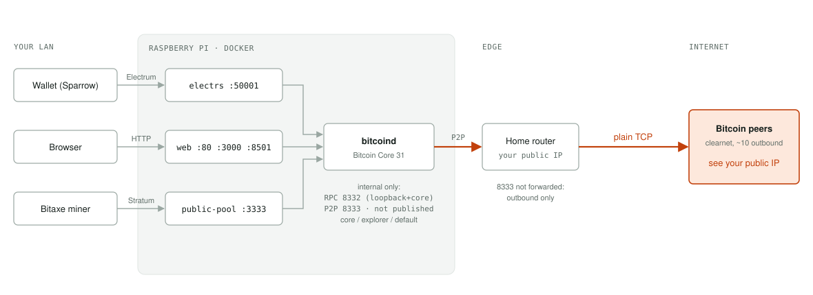
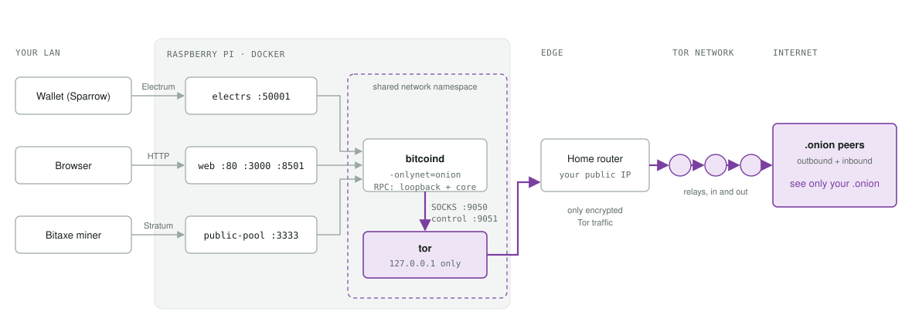

# Project Name


## Overview

This project provides an easy way to set up a minimal personal Bitcoin node on a Raspberry Pi. It focuses on simplicity and speed by offering both automatic and manual installation methods and supports fast initial blockchain synchronization using a downloadable UTXO snapshot. The node runs inside Docker containers, making it easier to manage, start, stop, and update. The repository includes clear instructions for installing dependencies, importing blockchain data, running the node, and keeping both the Raspberry Pi OS and Docker images up to date.

## Table of Contents

- [Overview](#overview)
- [Architecture](#architecture)
- [Features](#features)
- [Installation](#installation)

## Architecture

The node is composed of several Docker containers defined in `docker-compose.yml`. They are grouped into four functional areas.

### Core

- **bitcoin** (bitcoind) — The Bitcoin Core full node. It validates and relays blocks and transactions on the Bitcoin network. Electrs and the Mempool API both depend on it for blockchain data via RPC and cookie-based authentication. Public-pool accesses its data directory through a shared Docker volume.
- **electrs** — An Electrum server that indexes the blockchain from Bitcoin Core. It provides a lightweight query interface used by the Mempool API and can be connected to directly by wallet software (see below).

### Mempool Explorer

- **api** (mempool/backend) — The Mempool backend. It queries electrs for indexed blockchain data, Bitcoin Core for RPC calls, and the MariaDB database for cached statistics.
- **db** (mariadb) — Stores Mempool statistics and cached data. Used exclusively by the API and waited on by the web frontend at startup.
- **web** (mempool/frontend) — The Mempool web UI. It serves the block explorer frontend and proxies API requests to the backend.

### Monitoring

- **grafana** — Dashboard UI for visualizing metrics from Prometheus.
- **prometheus** — Collects and stores metrics by scraping node_exporter, json_exporter, and cadvisor.
- **node_exporter** — Exposes host-level system metrics (CPU, memory, disk, network) to Prometheus.
- **json_exporter** — Scrapes JSON APIs and converts them to Prometheus metrics. Configured to monitor Bitaxe miners (hash rate, temperature, power, voltage, shares, etc.).
- **cadvisor** — Exposes per-container resource usage metrics (CPU, memory, network) to Prometheus.

### Mining

- **public-pool** — A solo mining pool that uses the Stratum protocol. It reads blockchain data from Bitcoin Core through a shared Docker volume. Miners (such as a Bitaxe) connect to this service to submit work.

### External Ports

The canonical table, with the authentication status of every port and the ports
that stay container-only, is **[docs/exposure.md](docs/exposure.md)**. In short,
the default mode publishes **80** (explorer), **3000** (dashboards), **3333** and
**3334** (stratum), **50001** (Electrum) and **8501** (address tracker). None of
them carry authentication, so treat everything on your LAN as able to open them.
The test network publishes **40001**, **44224** and **9090** instead and drops the
miner and tracker ports; the import mode publishes nothing.

The node's RPC port is **not** published any more: it is bound to loopback and to
the node's fixed address on the internal `core` network, so only electrs, the
explorer API, the metrics exporter and the miner pool can reach it.

**Adding a port means adding a row** to `docs/exposure.md` in the same change.

### Connecting external devices

**Wallet software** — To use your own node instead of a third-party server, configure your wallet's Electrum server setting to `<node-ip>:50001`. This works with wallets like Sparrow Wallet, Electrum, and BlueWallet. Your transactions stay private because lookups never leave your network.

**Bitaxe miner** — In the Bitaxe web UI, set the Stratum URL to `<node-ip>` and the port to `3333`. This points the miner at your local public-pool instance for solo mining. Miner statistics (hash rate, temperature, power draw, shares) are automatically collected by json_exporter and visible in Grafana.

## Features

List some key features of the project.

- Install minimal personal bitcoin node
- Fast initial blockchain sync using snapshot

## Automatic Installation

1. Install Raspberry Pi OS ( https://www.raspberrypi.com/software/ )
2. Open a terminal session to the Raspberry Pi
3. Forcing PCI Express Gen 3.0 ( sudo nano /boot/firmware/config.txt and add the lines dtparam=pciex1 and dtparam=pciex1_gen=3 to the end of the file )
4. Reboot ( sudo reboot )
5. Open a terminal session to the Raspberry Pi
6. Install pre-requisites ( sudo apt-get install docker docker-compose git -y && git clone https://github.com/cedrickoch/BitcoinNode.git && cd BitcoinNode && ./install.sh )
7. Open a terminal session to the Raspberry Pi
8. Import the bitcoin snapshot ( cd BitcoinNode && ./install.sh )

## Manual Installation

Step by step instructions:

1. Install Raspberry Pi OS ( https://www.raspberrypi.com/software/ )
2. Open a terminal session to the Raspberry Pi
3. Update the OS to the latest version ( sudo apt-get update and sudo apt-get upgrade -y )
4. Install docker as described at https://docs.docker.com/engine/install/debian/
5. Install pre-requisites ( sudo apt-get install git -y )
6. Forcing PCI Express Gen 3.0 ( sudo nano /boot/firmware/config.txt and add the lines dtparam=pciex1 and dtparam=pciex1_gen=3 to the end of the file )
7. Reboot ( sudo reboot )
8. Open a terminal session to the Raspberry Pi
9. Change to the installation directory ( e.g. cd /home/bitcoin )
10. Clone the repository ( git clone https://github.com/cedrickoch/BitcoinNode.git )
11. Change to the BitcoinNode folder ( cd BitcoinNode )
12. Create `.env` and let it fill the credentials ( ./scripts/generate-secrets.sh )
13. Download the bitcoin data snapshot ( curl https://www.lopp.net/download/utxo-snapshot-height-840000.dat?ref=blog.lopp.net --output utxo-snapshot-height-840000.dat )
14. Import the bitcoin snapshot. It will take a while ( docker compose -f docker-compose-import.yml up )
15. Verify the snapshot before trusting it ( see [docs/trust.md](docs/trust.md) )
16. Start the bitcoin node ( docker compose up -d )

## Credentials

Every credential lives in `.env`, which is gitignored. Nothing uses a password
that is written in the repository.

```sh
cp .env.example .env
./scripts/generate-secrets.sh        # fills every blank value with a random one
```

The script is safe to re-run: it never overwrites a value you set, and it prints
one warning per value it had to generate. Compose references each secret as
`${VAR:?…}`, so a blank value stops the start instead of quietly falling back.

**Rotating a database password** keeps your explorer data — it changes the grant
in the running database and `.env` together, then restarts the consumers:

```sh
./scripts/rotate-db-password.sh app      # explorer database user
./scripts/rotate-db-password.sh root     # database superuser
```

**Backups:** `.env` carries the credentials, so back it up with the volumes. A
restored data volume without `.env` comes up with a password the database does
not know.

The Tor control password is used only in private mode; rotate it by editing
`.env` and restarting the private mode stack.

## Checking the hardening posture

```sh
./scripts/audit-hardening.sh          # every service, every baseline key
```

It prints `ok`, `deviated` (a row in `docs/hardening-baseline.md` explains it),
`DRIFT` (undocumented — fix it), or `stale-deviation` (a row that no longer
applies — remove it). Exit code is non-zero with any drift.

The baseline itself, with the reasons for every accepted deviation, is
`docs/hardening-baseline.md`. Nothing may deviate without a row there.

## Updating images deliberately

Tags are pinned to exact versions, so nothing changes under you. To see how old
they are, and to refresh on purpose:

```sh
./scripts/refresh-images.sh          # report age, flag anything unpinned
./scripts/refresh-images.sh --pull   # actually refresh
docker compose up -d                 # apply
./scripts/security-status.sh         # confirm it still works
```

A refresh mid-sync is safe but re-downloads. What each image rests on is recorded
in [docs/trust.md](docs/trust.md), which is also where the snapshot verification
step lives (see "Run modes" → snapshot import).

## Run modes

The stack has one default mode and three alternative modes. Each alternative
lives in its own overlay file and is brought up **on its own** — the overlays
are not stacked on the default file, because each one already defines the whole
stack. Always run one mode at a time; two at once share the same volume names
and will reconfigure each other.

Run `scripts/check-compose-syntax.sh` and `scripts/check-overlay-parity.sh` after
changing any compose file. The first catches quote/flow errors that would
otherwise only surface at `up` time (`must be a string`). The second verifies
every overlay still carries the hardening baseline of the default mode and exits
non-zero on drift; see `docs/hardening-baseline.md`.

| Mode | File | Purpose |
| --- | --- | --- |
| Default | `docker-compose.yml` | Mainnet node with explorer, monitoring and solo mining. |
| Private | `docker-compose.private.yml` | Default mode (stacked) with all peer traffic routed through Tor. |
| Test network | `docker-compose-testnet4.yml` | Throwaway testnet4 node for trying changes before mainnet. |
| Snapshot import | `docker-compose-import.yml` | One-shot bootstrap that loads a UTXO snapshot into `bitcoin_data`. |

### Default mode

```sh
docker compose up -d          # start
docker compose down           # stop
```

### Test network (testnet4)

Runs the same services as the default mode against testnet4, on ports 40001 and
44224 instead of 50001. Use it to try a change without waiting for a mainnet sync.

```sh
docker compose -f docker-compose-testnet4.yml up -d    # start
docker compose -f docker-compose-testnet4.yml down     # stop
```

Testnet4 data and mainnet data share the `bitcoin_data` volume, so switching
between them re-syncs rather than merging the two chains. Expect a fresh sync
each time you switch.

### Snapshot import

One-shot mode that loads the snapshot you downloaded into `bitcoin_data` so the
first mainnet sync is short. It has no long-running services of its own and is
not left running.

**Verify the import before trusting it.** A download proves nothing on its own;
the network's accumulated work does. Once the node has caught up, compare the
block hash at the snapshot height with the value in [docs/trust.md](docs/trust.md):

```sh
docker exec -u bitcoin bitcoind bitcoin-cli getblockhash 840000
```

A mismatch means delete the volume and re-import or re-sync.

```sh
docker compose -f docker-compose-import.yml up         # run the import
docker compose -f docker-compose-import.yml down       # clean up when it exits
docker compose up -d                                   # then start the node normally
```

### Coming from the old Bitaxe monitoring overlay

The former `docker-compose-with-bitaxe-monitor.yml` has been retired: miner
monitoring is part of the default mode, so nothing is lost. To migrate:

```sh
docker compose -f docker-compose-with-bitaxe-monitor.yml down   # if still up
docker compose up -d
```

The retired file stored chain data under `/data/.bitcoin`, while the current
image uses `/home/bitcoin/.bitcoin`. You can either point the mount back at
`/data/.bitcoin` in `docker-compose.yml` to keep the existing data, or re-sync
from scratch. The `bitaxe` target in `prometheus/prometheus.yml` is unchanged and
keeps being scraped by the default mode.

### Reverting to the default mode

```sh
docker compose -f docker-compose-testnet4.yml down
docker compose up -d
```

For private mode, see the next section: either comment the `COMPOSE_FILE=` line
back out in `.env` or run `docker compose -f docker-compose.yml up -d`.

## Private mode (Tor)

By default the node talks to other Bitcoin peers over the normal internet, so every peer can see your public IP address. In private mode all peer-to-peer traffic goes through Tor, so the node only talks to `.onion` peers and your IP stays hidden. Devices on your local network (wallets, Bitaxe, browser) still connect directly to `<node-ip>` exactly as before. Only the node's traffic to the Bitcoin network goes through Tor.

**Normal mode:** bitcoind connects to peers directly through your router, so every peer sees your public IP.



**Private mode:** bitcoind can only reach the internet through the tor container, which listens on 127.0.0.1 inside bitcoind's network namespace. Peers only see the node's `.onion` address.



1. Create the config file ( cp .env.example .env )
2. Set a random control password in `.env` ( e.g. TOR_CONTROL_PASSWORD=<output of openssl rand -hex 32> )
3. Start in private mode ( docker compose -f docker-compose.yml -f docker-compose.private.yml up -d )

To always start in private mode, uncomment the `COMPOSE_FILE=` line in `.env`. After that, a plain `docker compose up -d` uses Tor. To go back to normal mode, comment it out again, or run `docker compose -f docker-compose.yml up -d`. Switching modes recreates the bitcoind container.

Verify that private mode is active:

- `docker logs bitcoind | grep -i tor` shows `Got tor service ID ...` and the node's `.onion` address
- `docker exec -u bitcoin bitcoind bitcoin-cli getnetworkinfo` shows `ipv4` and `ipv6` as `"reachable": false`, and only an `.onion` address under `localaddresses`
- `docker exec -u bitcoin bitcoind bitcoin-cli getpeerinfo | grep '"network"'` lists only `onion` peers

## Stop node

1. Change to the BitcoinNode folder ( cd BitcoinNode )
2. Stop all docker containers ( docker-compose down )

## Start node

1. Change to the BitcoinNode folder ( cd BitcoinNode )
2. Start all docker containers ( docker-compose up -d )

## Update Raspberry Pi OS

1. Stop node
2. Update the package repository ( sudo apt-get update )
3. Upgrade the OS ( sudo apt-get upgrade -y )
4. Restart the Raspberry PI ( sudo reboot )
5. Login with SSH
6. Start node

## Update docker images

Tags are pinned, so use the deliberate path instead of a blind pull:

```sh
./scripts/refresh-images.sh --pull
docker compose up -d
./scripts/security-status.sh
```

## Health and troubleshooting

```sh
./scripts/security-status.sh
```

One line per service with `healthy`, `starting`, `unhealthy` or `no-healthcheck`,
then `OVERALL`. Non-zero exit unless everything is healthy.

First steps per symptom:

- **`bitcoin` unhealthy** — it reports healthy only once it is out of initial
  block download. Check progress: `docker compose exec bitcoin bitcoin-cli getblockchaininfo`.
  A stalled node with peers connected is usually disk or clock; check
  `docker compose logs --tail 50 bitcoin` and `df -h`.
- **`electrs` unhealthy** — it needs bitcoind healthy first. If bitcoind is fine,
  read `docker compose logs --tail 50 electrs`; a corrupted index means deleting
  the `electrs_data` volume and letting it re-index.
- **`api` / `web` unhealthy** — almost always `db`. Check `docker compose logs --tail 50 db`,
  and confirm `.env` still holds the credentials the database was initialised with.
- **`db` unhealthy** — disk full or a credential mismatch after a hand edit.
  `scripts/rotate-db-password.sh app` re-syncs password and grant in one step.
- **`tor` unhealthy** — private mode only. Check `docker logs bitcoind | grep -i tor`;
  a missing or wrong `TOR_CONTROL_PASSWORD` is the usual cause.
- **Many services unhealthy at once** — suspect the host (disk, memory) before the
  stack: `df -h`, `free -h`, `docker compose ps`.

Logs are capped at 10 MB × 3 files per service, so a long-running problem will
not fill the card.

## Checking exposure

The full port list with authentication status is [docs/exposure.md](docs/exposure.md).
If a port you do not recognise answers, `docker compose ps` plus that file will
name it.
